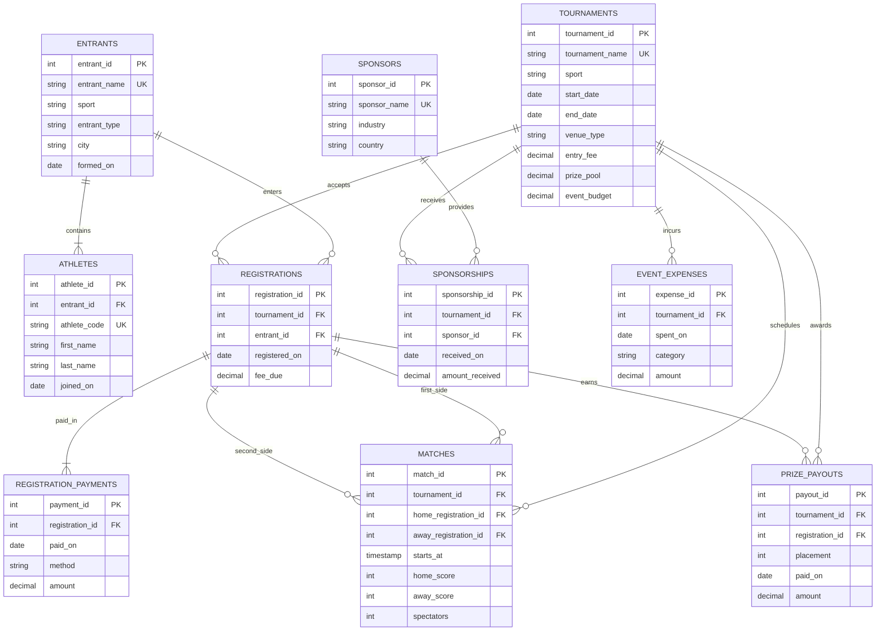

# ArenaForge Sports | Database Project (OIM6301)

## 1. The Scenario

**Option E — My own domain: a community sports tournament organizer.**

ArenaForge Sports is a **fictional company** that organizes paid amateur tournaments in **soccer 7 (7-a-side soccer), basketball, padel doubles, and tennis singles** in the Boston area. It currently keeps participants, registrations, installment payments, match scores, sponsors, venue costs and prize payments in separate spreadsheets. Management wants one database to compare tournament profitability, identify its strongest competitors and detect payment mistakes.

**What the business keeps today**

- **Entrants:** an entrant is a soccer or basketball team, a pair in padel, or an individual player in tennis. We keep the display name, sport, entrant type, home city and date formed. The unique numeric ID is stable when the name changes.
- **Athletes:** first and last name, stable athlete code, entrant, and joining date. Each athlete belongs to one current entrant. Each soccer entrant has seven athletes; each basketball entrant has five; each padel pair has two; each tennis entrant has one.
- **Tournaments:** tournament name, sport, start and end dates, venue type, entry fee per entrant, prize pool and event budget.
- **Registrations:** an entrant joining a tournament, including date and amount owed. The same entrant cannot register twice for the same event.
- **Registration payments:** one registration may have one payment or several installments. Each payment includes method, date and amount.
- **Matches:** one scheduled contest between two registrations in the same tournament; start time, score and estimated **in-person spectators**. In soccer the score means goals, in basketball it means points, and in padel/tennis it means sets won. The simplified dataset gives every match a winner, so no score is tied.
- **Sponsors and sponsorships:** each sponsor has a name, industry and country; each sponsorship links one sponsor with one tournament and stores the amount actually received and its date. Some sponsors have no sponsorship agreements.
- **Event expenses:** one operational cost attached to one tournament (venue, officials, marketing, staff or equipment), with date and amount.
- **Prize payouts:** money paid for first, second or third place, attributed to a tournament registration, including amount and payment date.

**Business rules**

1. Each entrant, athlete, tournament and sponsor has a primary key. Display names and athlete codes are unique where relevant, but names are not used as foreign keys.
2. Every athlete belongs to exactly one entrant; an entrant can have many athletes. The entrant's `entrant_type` must match its sport (enforced by a table `CHECK`). A **sport-specific roster size** is checked in a query: soccer 7 = seven, basketball = five, padel = two, tennis = one.
3. An entrant can register in many tournaments, but only once in each, and **only for its own sport**. This cross-table rule is checked with SQL.
4. Money amounts in entry fees, prize pools, budgets, registration payments, sponsorships, expenses and prize payouts are positive; match scores and spectator counts are nonnegative.
5. A tournament ends no earlier than it starts. Each match has two different participants, both registered in that tournament, and one winner. Its scores use the sport-specific scale described above.
6. **Each registration's total payments must equal its fee due.** This is a cross-row rule that cannot be enforced by a single-column `CHECK`; one SQL query must find all discrepancies.
7. A sponsor may support multiple events; an event can have multiple sponsors; some sponsors have no deals. A tournament can have multiple expenses and prize payouts.
8. For each completed event, the three prize payouts add up to the published prize pool; an entrant can collect at most one prize per event.
9. Revenue = money received from registrations + money from sponsors. Total cost = operating costs + prizes paid. Profit = revenue − total cost.
10. In the generated schedules there are five matches per day in nonoverlapping two-hour slots, on four consecutive days. A match's two registrations belong to its tournament.

**Eight required business questions for Part B**

1. Which tournaments earned the highest net profit after entry fees, sponsorships, operating expenses and prizes?
2. Which **sports** generated the most revenue and profit?
3. Which **entrants** achieved the highest win percentages, including entrants who never played?
4. Which sports generated the most registrations and registration revenue?
5. Which entrants have never registered for a tournament?
6. Which sponsors contributed the most, including those with no sponsorship agreements?
7. **(checks a rule)** Which registrations have payments that do not add up to the entry fee owed?
8. For every tournament, how many matches were played, how many distinct entrants won, and what was the average number of in-person spectators?

**Two additional manager questions for Part B:** (9) Which cost categories consumed most money in the last 90 days? (10) Which entrants earned the most prize money?

**Data policy:** The assignment explicitly allows an agent to generate fictional CSV data for a business scenario. `make_data.py` generates all ten tables deterministically from random seed `6301`, covering **November 2025–October 2026**, with `as_of = 2026-10-31`. None of these are genuine tournament results, people, organizations or cash transactions.

## 2. The ERD

`REGISTRATIONS` implements a many-to-many relationship between entrants and tournaments, adding registration date and fee due. `SPONSORSHIPS` implements a second many-to-many relationship between sponsors and tournaments, adding the amount and receipt date. The match table refers twice to registrations because each contest involves two distinct registered entrants.

## 3. What One Row Means

- **entrants:** Each row represents a team, a padel pair, or a tennis player.
- **athletes:** Each row represents one player and the team or pair they belong to.
- **tournaments:** Each row represents one tournament organized by the company.
- **registrations:** Each row represents a team or player signing up for a tournament.
- **registration_payments:** Each row represents one payment for a registration.
- **matches:** Each row represents one match between two participants.
- **sponsors:** Each row represents one company that can sponsor tournaments.
- **sponsorships:** Each row represents one sponsorship for a tournament.
- **event_expenses:** Each row represents one expense related to a tournament.
- **prize_payouts:** Each row represents one prize payment to a participant.

## 4. Design Choices

**Key choice:** I decided to use numeric IDs instead of names because names can change. This makes it easier to identify each team, player or sponsor without problems.

**Optional relationships:** Some teams or players may not have registered for any tournament yet. Also, some sponsors may not have sponsored any event.

**Rule a column cannot hold:** A registration can have more than one payment. Because of this, I need to add all the payments together to check if the total is correct. I will use a SQL query to find any differences.

**A design decision I checked:** I wanted to use the same database for all four sports. Since tennis is played individually, padel in pairs, and soccer and basketball in teams, I checked that the tables could work for all of them. This way, I don't need different registration tables for each sport.

### Generated data and intentional errors

- 24 tournaments: 6 per sport. Each has 20 matches, so 480 matches overall.
- 48 entrants: 12 per sport, including 4 entrants with no registrations. 180 athletes: 84 soccer, 60 basketball, 24 padel and 12 tennis.
- 16 fictional sponsors, of which exactly 2 have no deals.
- **Exactly two incorrect payment totals**, deliberately generated for Question 7: `registration_id = 11` is **$17 underpaid**; `registration_id = 107` is **$20 overpaid**. All payment rows individually satisfy `amount > 0`.
- The generated examples for tennis are singles (best of three sets) and padel is doubles (best of three sets). Basketball scores are points, soccer 7 scores are goals; this is noted so users do not compare raw scores across sports.
- Amounts are shown in USD. `spectators` estimates on-site attendance per match; it is synthetic, not measured.

